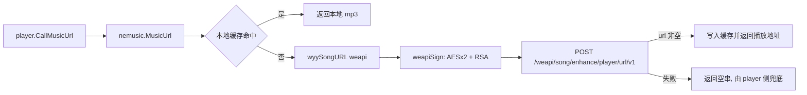

## 用户需求
把 `nemusic/nemusic.go` 第 98 行的 `MusicUrl` 中"第三方解析接口"改成参考 Python 示例的网易 weapi 自有实现，用于获取网易云音乐播放地址（含会员音质），并在配置中新增 cookie 字段。

## 功能要点
- 新增 `conf.Cfg.Cookie` 字段（json: `cookie`，默认空字符串），只通过 `workdayAlarmClock.json` 手改，不改网页设置页。
- `MusicUrl(id)` 改为：本地缓存命中 → 直接返回；未命中 → 调用 `https://music.163.com/weapi/song/enhance/player/url/v1?csrf_token=xxx` 取播放地址 → 拿到 `url` 直接返回并缓存。
- **外链 `/song/media/outer/url` 已失效，整段删除，不做兜底**（用户确认：只有 weapi 这一种了）。失败时返回空串，由 `player` 侧按既有逻辑处理（停下/兜底音乐）。
- 请求体：`ids` 为 `"[歌曲id]"`、`csrf_token`、`level` 取 `conf.Cfg.MusicQuality`（standard/exhigh/lossless/hires），**不传** `encodeType` 让接口自动决定格式。
- `csrf_token` 从 cookie 中提取 `__csrf=xxx`；取不到时传空字符串。
- 签名参数：`params` 为二次 AES-CBC 加密后的 base64，`encSecKey` 为随机密钥的 RSA 结果；请求头带 `Referer: https://music.163.com/`、`User-Agent` 和 cookie。
- 不判断响应里的 `type`（m4a/flac 也直接用，用户确认），只看 `url` 是否为空。
- 清理已被删除的 `nextMusicSongURL` 残留引用与相关结构体，保证工程可编译。

## 预期效果
配置了有效 cookie 时，可直接拿到对应音质的播放地址（含会员歌曲/无损）；未配置 cookie 时仍能拿到免费歌曲地址。获取失败则 `MusicUrl` 返回空串，行为与现状一致。

## 技术栈
- 语言/版本：Go 1.21（沿用 `go.mod`）
- 加密：标准库 `crypto/aes`、`crypto/cipher`、`crypto/rand`、`math/big`、`encoding/base64`、`encoding/hex`，**不新增第三方依赖**
- HTTP：沿用 `github.com/zanjie1999/httpme v1.2.0`（`req.Post(url, httpme.Datas{...}, httpme.Header{...})`，Content-Type 默认 `application/x-www-form-urlencoded`；`Post` 会先清空 Header 中的 Cookie 再套用传入 Header，因此通过 Header 传 cookie 有效）

## 实现方案
### 网易 weapi 标准签名（修正 Python 示例的缺陷）
1. 明文 payload：`{"ids":"[歌曲id]","csrf_token":"...","level":"..."}`（`json.Marshal` 产生紧凑格式，等价于 `separators=(',',':')`）
2. `p1 = base64(AES-128-CBC-PKCS7(明文, key="0CoJUm6Qyw8W8jud", iv="0102030405060708"))`
3. 生成随机 16 位密钥 `key2`（字母表 `a-zA-Z0-9`，`crypto/rand` 取随机索引）
4. `params = base64(AES-128-CBC-PKCS7(p1, key2, 同一 iv))`
5. `encSecKey = hex( RSA( bytes( reverse(key2) ), e=0x10001, n=示例中的 modulus ) )`，左侧补 0 到 256 位
6. POST 到 weapi 地址，解析 `code == 200` 且 `data[0].url` 非空

关键点：
- Python 示例用 `base64.encodebytes` 会产生换行、且二次 AES 用的是同一个固定 key、`encSecKey` 又独立随机生成密钥，这三处都会导致签名失败；Go 实现按上面标准算法来（用户已确认"先按查到的标准实现，我来编译测试"）。
- PKCS7 补齐必须"整除 16 时补满 16 字节"，否则与网易解密端不一致。
- `url` 在响应里可能是 `null`（无版权/未登录 VIP），结构体字段用 `*string` 接收并判空，避免 panic（原 Python 靠 `except` 兜底）。
- 响应的 `code` 有两层（顶层与 `data[i]`），两层都判：顶层 `code != 200` 或 `data[0].code != 200` 或 `url` 为空 → 返回错误，并把 `message` 打日志。
- RSA 用 `math/big`：`SetBytes([]byte(reversedKey))` 作为明文，指数 65537，模数为示例中的 1024 位 hex 常量，结果 `fmt.Sprintf("%0256x", c)` 左侧补零。

### MusicUrl 重构（保持既有职责边界）
- 保留：缓存命中判断、`MusicQuality` 空值兜底、缓存上限清理 `removeOldestMp3IfFull`、`app.SendLocal("PAUSE")`、`SaveFile` 下载缓存。
- 替换：把原"standard 用外链 + 其他走 `nextMusicSongURL`"的整段分支替换为单一 `wyySongURL(req, id, conf.Cfg.MusicQuality)`；外链 302 逻辑直接删除，不再保留 `outerSongURL`。
- 删除 `nemusic.go` 顶部 23-52 行已无用的 `nextMusic*` 结构体，去掉 133/145 行对 `nextMusicSongURL` 的调用（该函数已被用户手动删除，当前工程编译不过）。
- 日志遵循项目风格：`log.Println`，失败打印 `code/message/err`，**绝不打印 cookie 内容**（含 `MUSIC_U`，属敏感凭证）。

### 性能与可靠性
- 每首歌切换只多一次 HTTPS POST（几十毫秒级），AES/RSA 计算量为微秒级，可忽略；已有本地 mp3 缓存直接短路，不产生额外请求。
- 无并发共享状态，函数内新建 `httpme` 请求对象，与原实现一致，天然线程安全。
- 失败路径：网络错误 / `code != 200` / `url` 为空 → 打印原因并返回空串（不再有外链兜底）。
- 注意点：现有解码链路只有 `go-mp3`，`lossless/hires` 或接口返回 m4a 时可能无法解码；按用户要求不判断 `type`，保持直通。缓存文件名仍按 `id.mp3`。

## 架构设计


## 目录结构
```
workdayAlarmClockGo/
├── conf/
│   └── conf.go     # [MODIFY] Config 结构体新增 Cookie string `json:"cookie"`；Cfg 默认值新增 Cookie: ""（按注释风格加"网易云 cookie，用于获取会员音质，留空只取免费歌曲"）；Init/Save 无需改动，json 自动落盘
└── nemusic/
    ├── nemusic.go  # [MODIFY] 重写 MusicUrl：仅 weapi，删除外链 302 段；删除 23-52 行 nextMusic* 结构体及 133/145 行 nextMusicSongURL 调用；保持缓存/清理/暂停逻辑不变
    ├── wyy.go      # [NEW] weapi 实现：常量(AES key/iv/RSA modulus/exp/接口地址/UA)、wyySongURL、weapiSign、aesEncryptCBC(PKCS7)、randKey、rsaEncrypt、reverseString、csrfFromCookie、wyySongResponse 结构体
    └── wyy_test.go # [NEW] 离线单元测试：AES 加密后可用标准库解密还原（padding 正确、base64 无换行）、rsaEncrypt 输出 256 位 hex、csrfFromCookie 各种 cookie 串解析、weapiSign 产物长度符合预期（不发起网络请求）
```

## 关键函数签名
```go
// nemusic/wyy.go
func wyySongURL(req *httpme.Request, id string, level string) (string, error) // 返回播放地址
func weapiSign(text string) (params string, encSecKey string, err error)
func aesEncryptCBC(plainText []byte, key string, iv string) (string, error)  // 返回不带换行的标准 base64
func rsaEncrypt(text string) (string, error)                                 // 返回 256 位 hex
func randKey(n int) (string, error)
func csrfFromCookie(cookie string) string

// nemusic/nemusic.go
func MusicUrl(id string) string
```
